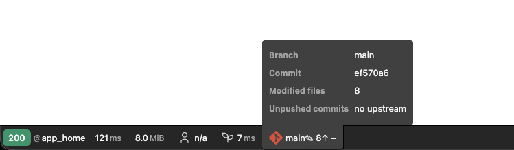
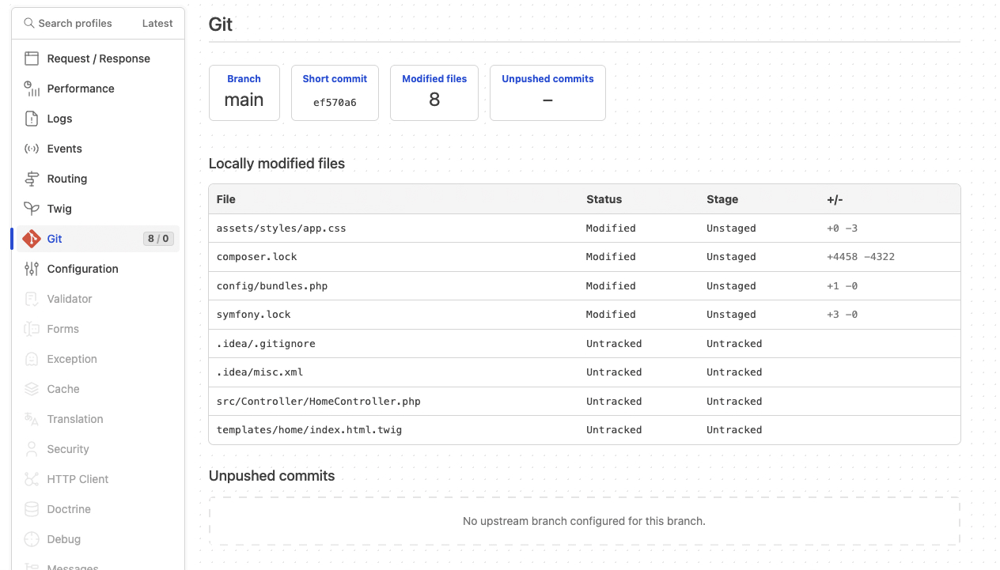
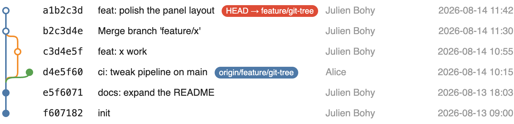

# GitProfilerBundle

[](https://packagist.org/packages/julienbohy/git-profiler-bundle)
[](https://packagist.org/packages/julienbohy/git-profiler-bundle)
[](https://github.com/julienbohy/symfony-git-profiler-bundle/actions/workflows/ci.yml)
[](LICENSE)


Symfony bundle that exposes the Git state of the current repository — **branch**, **short commit**,
**modified files** and **unpushed commits** — in a dedicated **Web Profiler** panel.

## Features

- Current **branch** and **short commit** of `HEAD`, in the profiler toolbar and panel.
- Live toolbar counters for **locally modified files** (✎) and **unpushed commits** (↑).
- **Commits behind the upstream** (↓) — as of the last fetch; the profiler never fetches.
- **Git commands** — every git command run for the request, with its duration and outcome.
- **Commit graph** — the recent commits of `HEAD` and its upstream drawn as a mini graph
  (lanes, merge and divergence curves), with `HEAD`/upstream badges; when an upstream is
  configured, hollow dots mark commits not pushed yet.
- Detailed **working-tree changes** — staged, unstaged and untracked — with their status
  (added, modified, deleted, renamed…).
- **Commits ahead of the upstream** (unpushed) with hash, message, author, date and the files they touch.
- **Zero configuration** — active as soon as the Web Profiler is, in `dev`/`test` only.
- **Lightweight and safe** — 3 to 7 git commands per request, run after the response is sent; the profiler never takes git's index lock (git 2.15+), and degrades cleanly when the directory is not a Git repository or git is unavailable.

## Screenshots

The compact **toolbar** segment — branch and counters at a glance:



The full **profiler panel** — working-tree changes and unpushed commits in detail:



The **commit graph** — `HEAD` and its upstream at a glance, merges and divergence included:



## Requirements

- PHP **8.3+**
- Symfony **6.4**, **7.4** or **8.x** (Symfony 8 requires PHP 8.4+)
- The `git` binary, **2.11+**, available in the runtime environment

## Installation

```bash
composer require --dev julienbohy/git-profiler-bundle
```

### Registering the bundle

From 0.3.0, with [Symfony Flex](https://symfony.com/doc/current/setup/flex.html), the
`symfony/recipes-contrib` recipe registers the bundle for the `dev` and `test` environments and
creates `config/packages/git_profiler.yaml` (see [Configuration](#configuration)). Contrib recipes
need your consent: answer **yes** to the Flex prompt during `composer require`, or allow them once
for the project with `composer config extra.symfony.allow-contrib true`.

Without the recipe, register the bundle in `config/bundles.php`, for the `dev` and `test`
environments only:

```php
return [
    // ...
    JulienBohy\GitProfilerBundle\GitProfilerBundle::class => ['dev' => true, 'test' => true],
];
```

The bundle is only useful in a development environment (Web Profiler): `dev` (and `test`) are enough.

## Usage

No configuration required. As soon as the profiler is active, a **Git** panel appears in the debug
bar and in the profiler.

In the (compact) **toolbar** you get the current **branch** followed by **two counters**: the number
of **locally modified files** (✎) and the number of **unpushed commits** (↑).

When the upstream has commits you have fetched but not merged, a third counter (↓) shows how many.

The **detailed panel** additionally shows:

- the **short commit** of `HEAD`;
- the **commit graph** — the last 30 commits of `HEAD` and its upstream, drawn with their lanes
  and merge/divergence curves; when an upstream is configured, hollow dots are commits not
  pushed yet, and badges mark `HEAD` and the upstream tip;
- the **list of uncommitted working-tree files** (staged, unstaged, untracked) with their status
  (added, modified, deleted, renamed…);
- the **list of local commits ahead of the remote** (unpushed) — short hash, message, author, date —
  **together with the list of files they touch**.

Unpushed-commit detection:

- it is based on the **upstream** branch (`@{u}`, e.g. `origin/main`); with no upstream configured,
  the section says so and the counters show `–`;
- the list of unpushed files is the **net diff** from the merge base, `@{u}...HEAD` (a file created
  then deleted within the range therefore does not appear, and changes that only exist upstream are
  never listed as yours when the branch has diverged).

If the directory is not a Git repository (or if `git` is unavailable), the panel states it cleanly —
no exception is thrown.

## Configuration

All options are optional. From 0.3.0, the contrib recipe creates `config/packages/git_profiler.yaml`
with every option commented out; without the recipe, create it yourself:

```yaml
when@dev:
    git_profiler:
        # git_binary: null        # path to git; null = looked up in the PATH
        # timeout: 5              # seconds per git command
        # graph_commit_limit: 30  # commits in the graph

when@test:
    git_profiler: null
```

When `git_binary` is null, the path of `git` is resolved once, when the container is built, and
cached with it: clear the cache (`bin/console cache:clear`) if git moves or its location changes.

## Tests

```bash
composer install
vendor/bin/phpunit
```

## License

MIT © 2026 Julien Bohy
