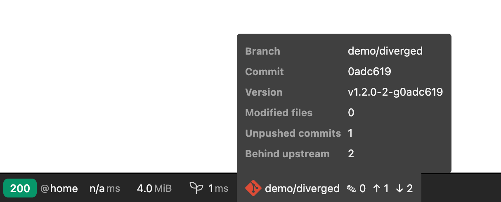
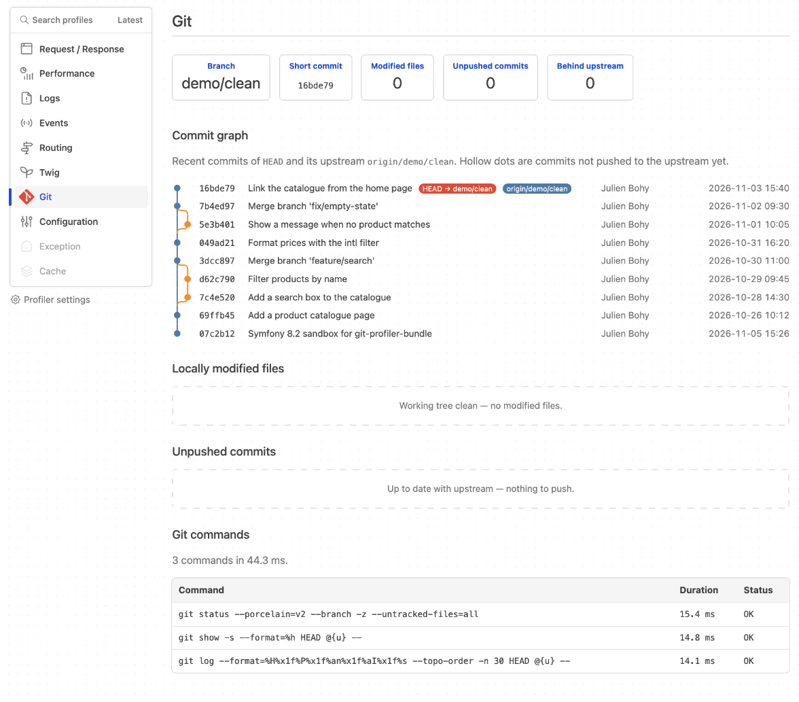
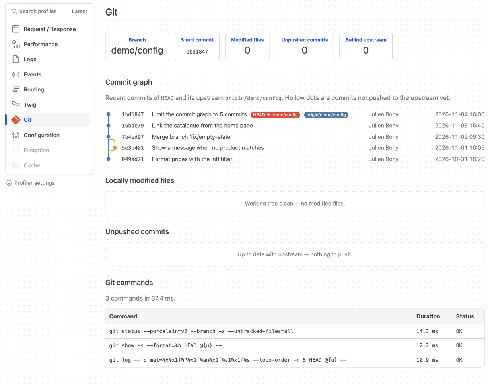
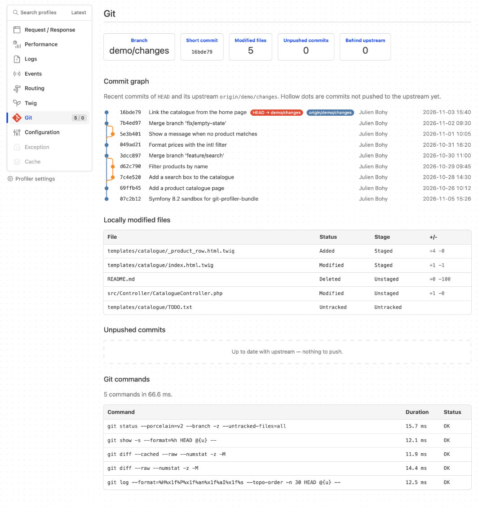
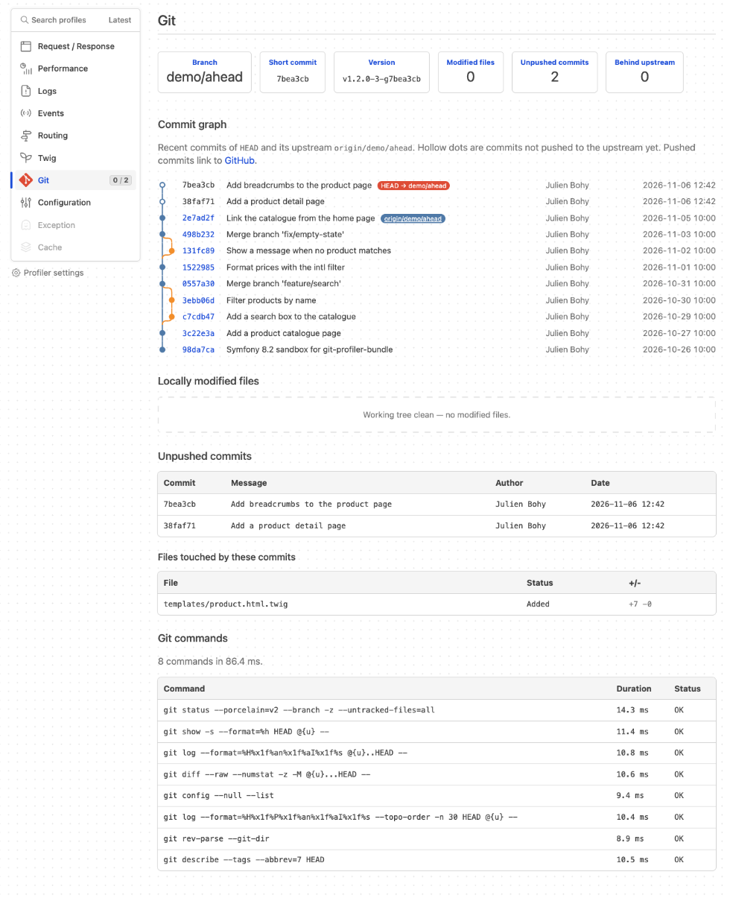
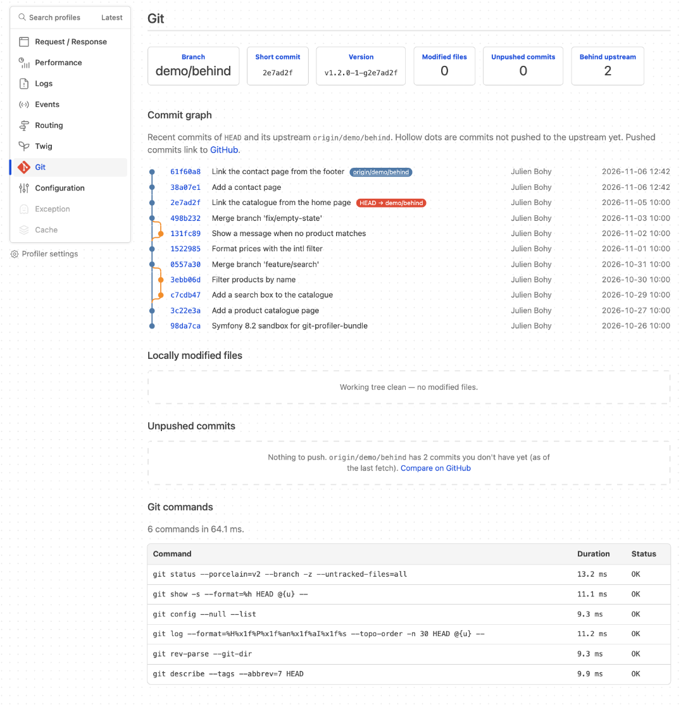
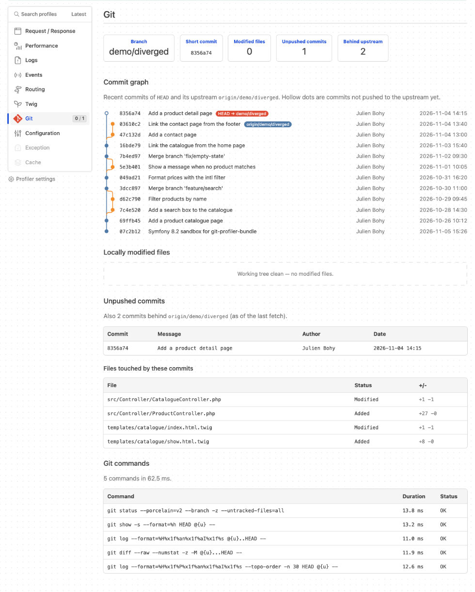
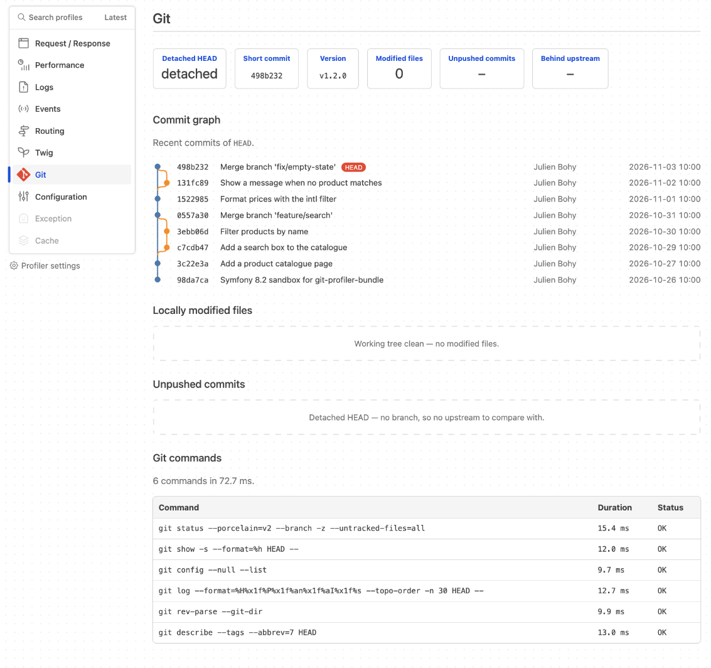
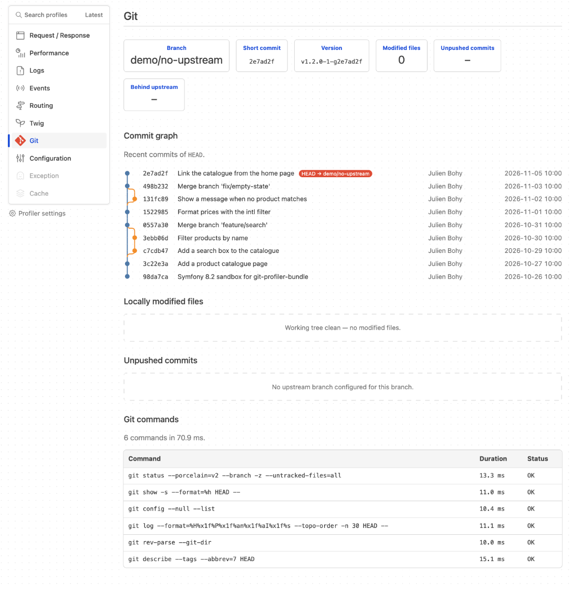

# The Git panel: what it shows and how it works

`julienbohy/git-profiler-bundle` adds a **Git** panel to the Symfony Web Profiler. It answers one
question while you develop: *what is the state of the repository this request was served from?*
Branch, uncommitted work, unpushed commits, and how far you are from the upstream, without leaving the
debug toolbar.

This page explains what each part shows, when it helps, and what the bundle does under the hood.
For installation, see the [README](../README.md).

- [What it shows](#what-it-shows)
- [Commit graph](#commit-graph)
- [Local changes](#local-changes)
- [Ahead, behind, diverged](#ahead-behind-diverged)
- [Operations in progress and conflicts](#operations-in-progress-and-conflicts)
- [Edge cases](#edge-cases)
- [Git commands](#git-commands)
- [Configuration](#configuration)
- [How it works and performance](#how-it-works-and-performance)
- [Limitations](#limitations)

## What it shows

### Toolbar



*Toolbar segment with its hover details, on a branch that diverged from its upstream.*

The segment shows the branch name followed by counters:

| Counter | Meaning |
|---|---|
| ✎ | Locally modified files: staged, unstaged and untracked. A file that is both staged and unstaged counts once. |
| ↑ | Commits not pushed yet (`@{u}..HEAD`). Shows `–` when there is no upstream. |
| ↓ | Commits on the upstream that you do not have, **as of the last fetch**. Only displayed when greater than 0. |

Hovering opens the detail block: branch, short commit, and the same three numbers. While an
operation is in progress the segment turns yellow (red with conflicts) and shows its label, e.g.
`rebasing 3/7` (see [Operations in progress and conflicts](#operations-in-progress-and-conflicts)).

The toolbar is a quick "am I about to test the right code?" check: wrong branch, forgotten local
edits, or a branch that is behind are visible on every page you open. The **Git** entry of the profiler
menu carries a `files / unpushed` badge when either number is non-zero.

### Summary cards



*A clean branch, in sync with its upstream. Three git commands, about 45 ms.*

The panel opens with five cards: **Branch** (or **Detached HEAD**), **Short commit**, **Modified
files**, **Unpushed commits** and **Behind upstream**. Cards without a meaning in the current state
show `–` (no upstream, detached HEAD). A **Conflicts** card is added when files have unresolved
merge conflicts, and a banner appears above the cards while an operation is in progress. Below come the commit graph, the local changes, the unpushed
commits, and the list of git commands that were run.

## Commit graph

The graph draws the latest commits reachable from `HEAD` **and** from its upstream, in topological
order, with one lane per line of history.

- **Badges** mark `HEAD → branch` (red) and the upstream tip, e.g. `origin/main` (blue).
- **Hollow dots** are commits that are not on the upstream yet. Without an upstream, "not pushed" has
  no meaning, so every dot stays filled.
- **Curves** between lanes show where a branch forked and where a merge brought it back. Merge commits
  are the ones where a second lane joins the main one.
- Each row shows the short hash, subject, author and date. Dates are converted to the browser's
  timezone with a small inline script (the server-side date is the fallback without JavaScript).

The graph uses `graph_commit_limit` (default 30) as the **total** number of commits for `HEAD` and
upstream together, not per side. With a limit of 5:



*`graph_commit_limit: 5`: the graph and its `git log -n 5` command shrink accordingly.*

When to use it: to see at a glance whether your branch is a straight line on top of the upstream, which
commits would be pushed, and where a merge happened, without running `git log --graph`.

## Local changes

The **Locally modified files** table lists the working tree against `HEAD`:

| Column | Content |
|---|---|
| File | Path; for renames, the previous path is shown ("formerly …") |
| Status | Added, Modified, Deleted, Renamed or Untracked |
| Stage | Staged (index vs `HEAD`), Unstaged (working tree vs index) or Untracked |
| +/- | Added and removed lines, from `git diff --numstat`. Not shown for untracked files. |

A file modified in the index and again in the working tree appears twice, once per stage, with the
line counts of each side.



*Five changed files: two staged, two unstaged (one deleted), one untracked. The toolbar badge in the
menu reads `5 / 0`.*

Useful when a request behaves differently from what the committed code says: you see immediately
whether you are running uncommitted edits, and whether they are staged. Untracked files are listed
individually (`--untracked-files=all`), so a new untracked directory is expanded to its files.

## Ahead, behind, diverged

Everything is relative to the **upstream** of the current branch (`@{u}`, e.g. `origin/main`).

**The profiler never fetches.** "Behind" is computed from the remote-tracking ref as it was after your
last `git fetch` or `git pull`. A teammate's push is invisible until you fetch. That is deliberate: no
network access, no credentials prompt, no latency, no side effect on your repository.

| State | Cards | Unpushed section |
|---|---|---|
| In sync | ↑ 0, ↓ 0 | "Up to date with upstream — nothing to push." |
| Ahead | ↑ N, ↓ 0 | Table of the N commits, then the files they touch. |
| Behind | ↑ 0, ↓ M | "Nothing to push. `origin/x` has M commits you don't have yet (as of the last fetch)." |
| Diverged | ↑ N, ↓ M | "Also M commits behind …" line, then the N commits and their files. |



*Two unpushed commits (hollow dots) and the files they touch.*



*Behind: nothing to push, the upstream has commits you have not merged. Toolbar counters: ✎ 0, ↑ 0, ↓ 2.*



*Diverged: one local commit, two upstream commits. The graph shows both tips, and the unpushed file
list contains only the local commit's changes.*

**How unpushed files are computed.** The commit list is `git log @{u}..HEAD`. The file list is
`git diff @{u}...HEAD` (three dots): a diff from the **merge base** to `HEAD`. On a diverged branch this
excludes changes that only exist upstream, which a plain two-dot diff would wrongly show as yours
(reversed). Consequence: the list is a net diff, so a file added and deleted inside the unpushed range
does not appear, and a file changed in several commits appears once with the combined +/-.

## Operations in progress and conflicts

A merge, rebase or cherry-pick that stopped halfway leaves the repository in a state that is easy to
forget, and that explains why the working tree "looks odd". The panel says so.


**Banner.** While an operation is in progress, a banner above the summary cards names it, with the
commands that continue or abort it. It is yellow, and red when files have conflicts (the number of
conflicts is part of the banner):

| Operation | Banner | Hint |
|---|---|---|
| Rebase | Rebasing `feature/x` onto `1a2b3c4` — step 3/7 | `git rebase --continue` · `git rebase --abort` |
| Merge | Merging `Merge branch 'other'` (first line of `MERGE_MSG`) | `git commit` · `git merge --abort` |
| `git am` | Applying patches (am) — 2/5 | `git am --continue` · `git am --skip` · `git am --abort` |
| Cherry-pick | Cherry-picking `abc1234` | `git cherry-pick --continue` · `git cherry-pick --abort` |
| Revert | Reverting `abc1234` | `git revert --continue` · `git revert --abort` |
| Bisect | Bisect in progress | `git bisect reset` |

**Toolbar.** The segment is yellow during an operation and red when there are conflicts, shows a
label (`rebasing 3/7`, `merging`, `am 2/5`, `cherry-picking`, `reverting`, `bisecting`) and a `⚠ N`
counter for the conflicts; the hover block gets an *Operation* and a *Conflicts* row.

**Rebase and detached HEAD.** `HEAD` is detached while a rebase is stopped. Instead of "Detached HEAD",
the first card (and the toolbar) read **Rebasing** with the branch being rebased. A rebase of a
detached HEAD has no branch to show and stays "Detached HEAD".

**Conflicts.** Unmerged paths come from the `u` records of `git status --porcelain=v2`. They are listed
first in *Locally modified files*, with the status `Conflict — <kind>`, the stage *Unmerged* and no
+/- counts:

| Kind | Status code | Meaning |
|---|---|---|
| both modified | `UU` | Changed on both sides |
| both added | `AA` | Added on both sides |
| both deleted | `DD` | Deleted on both sides |
| added by us / by them | `AU` / `UA` | Added on one side only |
| deleted by us / by them | `DU` / `UD` | Deleted on one side, changed on the other |

`git diff` also reports unmerged paths (as `U`, and as an extra `M` for the unstaged one), so they are
removed from the staged and unstaged diffs to appear once. When conflicts are the only changes, the two
diff commands are not run at all.

**How an operation is detected.** The bundle runs one extra command, `git rev-parse --git-dir`, to find
the git directory (`--absolute-git-dir` needs git 2.13; a relative result is resolved against the
project directory). It works for a normal repository, a linked worktree (`.git/worktrees/<name>`) and a
submodule. The path is then kept for the lifetime of the PHP process, and the files below are read
directly. The first match wins, in this order:

| Operation | Detected from |
|---|---|
| Rebase | `rebase-merge/` (`msgnum`, `end`, `head-name`, `onto`), or `rebase-apply/` without an `applying` file (`next`, `last`, `head-name`, `onto`) |
| `git am` | `rebase-apply/applying` (`next`, `last`) |
| Merge | `MERGE_HEAD`, and the first line of `MERGE_MSG` |
| Cherry-pick | `CHERRY_PICK_HEAD` |
| Revert | `REVERT_HEAD` |
| Bisect | `BISECT_LOG` |

`rebase-merge/` is used by interactive rebases and, since git 2.26, by every rebase; `rebase-apply/` by
older non-interactive rebases and by `git am`. Both layouts are handled. Full object ids are shortened
to 7 characters. If the git directory cannot be found or read, there is simply no operation (logged at
debug level on the `git_profiler` channel); the rest of the panel is not affected. Only one operation
is reported, so a bisect run during a rebase shows the rebase.

## Edge cases

### Detached HEAD



*Detached HEAD: no branch, so no upstream; unpushed and behind show `–`.*

The toolbar and the first card read `detached`, the badge on the graph is a bare `HEAD`, and the short
commit is still displayed. The graph shows `HEAD` only. Common after checking out a tag or a commit,
or in CI-like and rebase/bisect situations. During a rebase the card reads "Rebasing" instead (see
[Operations in progress and conflicts](#operations-in-progress-and-conflicts)).

### No upstream



*A local branch never pushed with `-u`: counters show `–`, dots are all filled.*

The branch exists but has no tracking branch. Ahead and behind cannot be computed, so the bundle says so
instead of showing `0`. Everything else (changes, graph of `HEAD`) works as usual. A configured upstream
whose remote ref is gone (deleted remote branch) is treated the same way.

### Not a repository, git missing, empty repository

The panel states "This directory is not a Git repository (or "git" is unavailable)". No exception is
thrown and the toolbar segment is not rendered. This covers: the project directory is not in a repo,
the `git` binary cannot be executed, `git status` fails or times out, and a repository without any
commit yet. The cause is not displayed in the panel; the "Git commands" section shows the failed
command with its error when one was attempted, and the exception is logged at debug level on the
`git_profiler` Monolog channel.

If only a secondary command fails (staged diff, unstaged diff, unpushed commits, graph), the
corresponding section degrades alone: it is empty and the rest of the panel stays usable.

## Git commands

The last section lists every git command run **for this request**, with its duration and outcome:


*Commands of the diverged case (see the bottom of the screenshot): status, show, log, diff, graph log.*

| Command | Purpose | Runs when |
|---|---|---|
| `git status --porcelain=v2 --branch -z --untracked-files=all` | Branch, upstream, ahead/behind, staged/unstaged/untracked | Always |
| `git show -s --format=%h HEAD @{u} --` | Short hashes of `HEAD` and the upstream | Always (`@{u}` only with an upstream) |
| `git rev-parse --git-dir` | Location of the git directory, to detect an operation in progress | Always, once per PHP process (so once per request under PHP-FPM) |
| `git diff --cached --raw --numstat -z -M` | Staged files | Something is staged |
| `git diff --raw --numstat -z -M` | Unstaged files | Something is unstaged |
| `git log … @{u}..HEAD --` | Unpushed commits | Upstream and ahead > 0 |
| `git diff --raw --numstat -z -M @{u}...HEAD --` | Files of the unpushed commits | Same |
| `git log … --topo-order -n <limit> HEAD @{u} --` | Commit graph | Always |

That is **4 to 8** commands. Every call is also prefixed with `-c log.showSignature=false -c
diff.relative=false` (to neutralise user config that would alter the output); those options are not
shown in the table.

How to read it:

- **Duration** is wall-clock time of the process, typically 10 to 20 ms each on a small repository.
  Large repositories, network file systems, antivirus scanning, Docker bind mounts on macOS, or huge
  untracked trees make `git status` the first to grow.
- **Failed** is shown in red with the error: git's stderr, or `exit code N`.
- **A timeout** appears as Failed with the Symfony Process message ("exceeded the timeout of 5
  seconds"). If it hits `git status` or `git show`, the whole panel falls back to the "not a Git
  repository" state; if it hits a later command, only that section is empty. Raise `timeout` or fix
  the underlying slowness.
- "No git command was run" means no command was recorded for this profile (for instance a profile stored before the bundle was enabled).

## Configuration

Zero configuration is required. All options are optional and live in `config/packages/git_profiler.yaml`
(created by the Flex recipe from 0.3.0, options commented out):

```yaml
when@dev:
    git_profiler:
        git_binary: null        # path to git; null = looked up in the PATH
        timeout: 5              # seconds per git command
        graph_commit_limit: 30  # commits in the graph (HEAD and upstream together)

when@test:
    git_profiler: null
```

| Option | Default | Notes |
|---|---|---|
| `git_binary` | `null` | Path to the executable. `null` resolves `git` in the `PATH` and falls back to the literal `git`. |
| `timeout` | `5` | Seconds, per command, minimum `0.1`. Supports `%env()%` placeholders. A value that resolves to `0` or less falls back to 5 (Symfony Process would otherwise mean "no timeout"). |
| `graph_commit_limit` | `30` | Integer, minimum `1`. |

`when@dev` / `when@test` are Symfony's per-environment config blocks. The bundle should be registered
for `dev` and `test` only (`['dev' => true, 'test' => true]` in `config/bundles.php`; the recipe does it).

**Cached binary path.** When `git_binary` is `null`, the path is resolved **once, when the container is
built**, and stored as a container parameter. If git is installed elsewhere afterwards (upgrade, new
Homebrew prefix, switching Docker image), run `bin/console cache:clear`. In `dev` the container is
usually rebuilt on config change but not on a `PATH` change.

## How it works and performance

Collection follows the Symfony data collector lifecycle, with one twist:

1. During the request, `collect()` does nothing. The response is not delayed by git.
2. After the response is sent (`kernel.terminate`), the profiler calls `lateCollect()`. That is when
   the git commands run, through `symfony/process`, with the project directory (`kernel.project_dir`) as
   working directory.
3. The results are stored in the profile, so the panel for a past request shows the state **as it was
   at that request**, not the current state of the repository.

Safeguards on every git process:

- `GIT_OPTIONAL_LOCKS=0`: `git status` does not refresh the index, so the profiler never takes
  `.git/index.lock` and cannot make your own `git add`/`commit` fail with a lock error (git 2.15+;
  older versions ignore the variable).
- `GIT_TERMINAL_PROMPT=0` and `LC_ALL=C`: no interactive prompt, stable parseable output.
- `GIT_DIR`, `GIT_WORK_TREE`, `GIT_INDEX_FILE`, `GIT_COMMON_DIR` and `GIT_PREFIX` are removed from the
  environment, so the app run from a git hook still reads its own repository.
- Read-only commands only. No `fetch`, `pull`, `remote update` or `ls-remote`: **no network access**.
- Linked worktrees and submodules (where `.git` is a file) are supported.

**Cost.** 4 to 8 short-lived processes per profiled request, about 10 to 20 ms each on a normal
repository; in the screenshots, 37 to 71 ms in total. Because this happens after the response, it adds
no latency to the page itself. It does keep the PHP worker busy a little longer: with PHP-FPM
(`fastcgi_finish_request`) the client is already released; with servers that do not flush before
`kernel.terminate`, the response may be held until collection ends.

**Worst case.** Each command is bounded by `timeout`, so the upper bound is `8 x timeout`, i.e. 40 s
with the default, if every command hangs (for example a stalled network file system). A hanging
`status` or `show` aborts the collection immediately (the panel becomes "unavailable"), so in practice
the bound is much lower. Lower `timeout` on slow mounts if you prefer to lose the panel over holding a
worker.

**Scope.** Intended for `dev` and `test`. It exposes branch names, commit subjects, author names and
file paths in the profiler, and spawns processes: do not enable it in `prod`.

## Limitations

- **No fetching.** Behind counts and the upstream graph reflect the last fetch. Run `git fetch` to
  refresh; the panel does not.
- **Requires `git` 2.11+** on the machine running PHP (`--porcelain=v2`). In a Docker setup that means
  inside the container, with the repository mounted and readable; git may refuse a repository owned by
  another user ("dubious ownership"), which shows up as a failed `git status`.
- **Project directory only.** It reads the repository containing `kernel.project_dir`, not other repos,
  vendor packages or submodule contents.
- **Snapshot per request.** Each profile stores the state at the time of that request.
- **Graph is a window**, not the whole history: `graph_commit_limit` commits in total, topologically
  ordered; a long-lived upstream far ahead can push your own commits out of view.
- **Unpushed files are a net diff** from the merge base (see above), not a per-commit breakdown.
- **Dates** use the browser timezone through JavaScript; the commit time itself comes from git's author
  date.
- **One operation at a time.** If several are in progress (for example a bisect during a rebase), only
  the first by precedence is shown. The sequencer's own todo list (a multi-commit cherry-pick) is not read.
- **Not shown:** stashes, tags, other local branches, submodule status.
